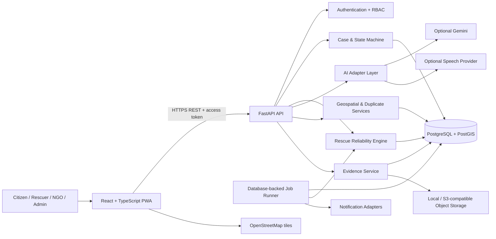

# ResQNet — System Architecture (Stage 1)

## 1. Architecture decision

ResQNet is a modular monolith: one FastAPI application, one React application, and one PostgreSQL database with PostGIS. Modules are separated by business capability, but deployed together. This keeps local development and hackathon deployment manageable while preserving clear boundaries.

## 2. High-level component flow

## 3. Backend module boundaries

- `auth`: identity, sessions/tokens, role and organization membership checks.
- `cases`: reports, case records, validated state transitions, public tracking projection.
- `triage`: deterministic priority rules, explanation, human override.
- `duplicates`: candidate generation using PostGIS distance/time filters; human-confirmed merge only.
- `responders`: skills, service areas, availability, capacity and eligibility.
- `assignments`: offers, accept/reject, acknowledgement deadlines, atomic assignment ownership.
- `reliability`: deadline scans, escalation policy, reassignment offers and overdue queues.
- `handoffs`: request/accept/reject; sender remains accountable until acceptance.
- `evidence`: upload validation, private object storage, evidence metadata and access policy.
- `outcomes`: submission, coordinator verification, dispute and reopen.
- `notifications`: persisted in-app notifications and optional provider adapters.
- `audit`: append-only record of sensitive actions and actor identity.
- `analytics`: database-derived operational metrics.

Modules may call one another through service functions in the same process. Do not create internal HTTP calls between modules.

## 4. Core reliability invariants

1. Every non-terminal case has an accountable owner (organization and, when assigned, a named owner).
2. An assignment offer is not an accepted assignment.
3. An expired offer is atomically marked expired before another offer is issued.
4. Only one active assignment may own a case at a time (database constraint plus transaction/row lock).
5. A handoff request does not transfer responsibility. Responsibility changes only after explicit acceptance.
6. Arrival, assistance and outcome verification are distinct events.
7. Only an authorized coordinator can verify closure; verification requires submitted outcome evidence or a documented exception policy.
8. Every state change and override creates an immutable case event and audit entry in the same transaction.
9. Deadlines are stored as UTC timestamps. UI renders them in the user's local timezone.
10. Background processing is at-least-once; every job handler must be idempotent.

## 5. Authentication and authorization

For the first implementation, use first-party email/password authentication with Argon2 password hashing and short-lived signed access tokens, plus refresh-token rotation stored hashed in the database. Firebase can be added behind the auth adapter later. Every protected endpoint checks both role and organization scope in the backend; frontend route guards are only a usability feature, never the security boundary.

Roles: `CITIZEN`, `RESCUER`, `NGO_COORDINATOR`, `ADMIN`. Organization membership is a separate relation so one user may belong to more than one organization. Admin actions are explicitly audited.

## 6. AI boundaries

AI is advisory. Provider interfaces return structured data with source, confidence/uncertainty, model/provider name and timestamp. AI extraction never writes directly to a case. The citizen confirms extracted fields before submission. Triage remains deterministic and explainable; uncertain cases are routed to human review. Image classification may suggest an animal category only and must not diagnose injury or severity.

Local mode must work without API keys: manual reporting, deterministic triage, no-op notification adapters and clearly labelled development speech/AI adapters.

## 7. Data and privacy

- PostgreSQL is the source of truth; PostGIS stores incident and responder geometry.
- Store uploaded files outside the public web root. Persist object key, MIME type, byte size, SHA-256, uploader and access classification.
- Public tracking exposes a random public tracking token and coarse location only; never expose reporter phone, exact home coordinates or private evidence URLs.
- Keep audit and case-event history append-only. Use soft deletion for user-facing records where lawful; retention policy governs personal data and evidence separately.
- Record consent for voice and image uploads.

## 8. Background jobs

Use a database-backed job table and a separate lightweight worker process. A periodic poller claims due jobs with `FOR UPDATE SKIP LOCKED`, records attempts and leases, and retries transient failures with backoff. The same database is used for job state, so no Redis dependency is required for the MVP. Production can move to a managed queue without changing business services.

## 9. Deployment shape

- Frontend: static Vite build on any static host.
- API and worker: two processes from the same backend image/package.
- Database: managed PostgreSQL with PostGIS in production; local PostgreSQL for full geospatial development.
- Evidence: local private storage in development; S3-compatible bucket in production.
- Docker Compose is provided as an optional reproducible environment, not required for a lightweight local start.

## 10. Key risks and mitigations

| Risk | Mitigation |
|---|---|
| False AI extraction or mistranscription | Show source transcript, uncertainty and editable fields; require citizen confirmation |
| False urgency classification | Rules with visible reasons; human override and audit |
| Duplicate reports | Suggest candidates only; coordinator confirms merge |
| Responder no-show | Persisted deadline, retryable worker, escalation queue and manual escalation action |
| Double assignment under concurrency | Database transaction, row lock and unique partial constraint |
| Handoff ambiguity | Sender retains ownership until receiver accepts |
| Fake rescue completion | Separate accepted, arrived, assisted and verified states |
| Location/privacy leakage | Coarse public location, scoped API, private evidence storage |
| External API outage | Provider adapters, timeouts, circuit/fallback behavior and manual workflow |
| Insufficient real-world partners/data | Synthetic demo is labelled; no claims of live NGO or government integration |

## 11. Stage gates

Stage 1 is complete when API contracts, state transitions, data model and module boundaries are agreed. Stage 2 starts with project dependencies, database connectivity, migrations, auth and seed accounts. Each later stage must pass its own tests before moving forward.
